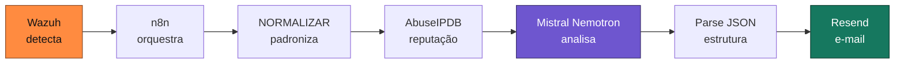

# 🦊 Workshop SOC, SIEM e IA na Prática

> Construção de um **mini SOC automatizado**, do zero, em 3 encontros — com **Wazuh**, **n8n** e **Inteligência Artificial**.

Material e artefatos do workshop prático que ministrei para a **[Imperium Fox Academy](https://www.linkedin.com/in/gabriel-shtx/)**, voltado a iniciantes em Segurança da Informação. Os participantes saem com um laboratório funcional: um evento é **detectado** no Wazuh, **enriquecido** com threat intelligence, **analisado** por IA e entregue como um **e-mail acionável** — sem ninguém no meio do caminho.


---

## 🎯 O problema

Uma invasão leva, em média, **meses** para ser percebida. Não porque falta ferramenta — a empresa tem antivírus, firewall, VPN, tudo gerando log. Falta **alguém lendo**. E quem lê afunda em **fadiga de alerta**: entre 100 alertas, 99 costumam ser ruído.

Este workshop ataca os dois lados: ensina a **construir o olho** que vê (SIEM), a **investigar** o que ele reporta, e a **automatizar a triagem** para que o analista gaste tempo com o que exige julgamento — não com o mecânico.

---

## 🧩 O que foi construído



Um alerta entra numa ponta. Um **e-mail investigado** — com veredito, reputação do IP, ações imediatas e passos de investigação — sai na outra. Isso tem nome no mercado: **SOAR** (orquestração e automação de resposta). Construído aqui do zero, com ferramentas gratuitas.

---

## 📚 As três aulas

| # | Aula | O que o participante aprende |
|---|------|------------------------------|
| **1** | **Fundamentos** | O que é um SOC e seu ecossistema, a cadeia `log → evento → alerta → incidente`, MITRE ATT&CK, e sobe o **Wazuh** com um agente conectado. |
| **2** | **Detecção e Investigação** | Como o SIEM decide (decoder × regra), severidade, IOC e TTP, escreve a **própria regra**, ataca o lab com **Atomic Red Team** para testá-la, e investiga o resultado numa dinâmica de casos. |
| **3** | **IA e Integração** | Onde a IA ajuda (e onde não), e monta o **pipeline completo**: Wazuh → n8n → AbuseIPDB → Mistral Nemotron → Resend. Fecha publicando o projeto como portfólio. |

> Cada aula tem seu resumo em [`docs/`](docs/).

---

## 🗂️ Estrutura do repositório

```
workshop-soc-siem-ia/
├── docs/                        # Resumo das 3 aulas e a arquitetura
│   ├── aula-01-fundamentos.md
│   ├── aula-02-deteccao-investigacao.md
│   ├── aula-03-ia-integracao.md
│   └── arquitetura.md
├── wazuh/                       # Detecção
│   ├── local_rules.xml          # Regras personalizadas do workshop
│   ├── custom-n8n.py            # Script de integração Wazuh → n8n
│   └── ossec-integration.md     # Como plugar o Wazuh no n8n
├── n8n/                         # Orquestração
│   ├── README.md                # Visão dos nodes, prompt da IA e parse
│   ├── workflow.json            # Exporte o seu fluxo do n8n aqui
│   └── email-template.html      # E-mail HTML do alerta (Resend)
├── scripts/
│   └── simulate_wazuh_attack.sh # Simula o cenário sem atacar de verdade
├── images/                      # Prints e diagramas (adicione os seus)
├── .env.example                 # Chaves de API em branco (modelo)
└── README.md
```

---

## ⚙️ Como o pipeline funciona

1. **Wazuh** detecta o cenário (ex.: força bruta SSH seguida de login com sucesso) e dispara um alerta de nível alto.
2. Uma **integração** no `ossec.conf` faz o Wazuh chamar o **webhook do n8n** para todo alerta acima de um nível.
3. **NORMALIZAR** reduz o alerta cru a um punhado de campos previsíveis.
4. **AbuseIPDB** consulta a reputação do IP de origem.
5. **Mistral Nemotron** (via API da NVIDIA) recebe todo o contexto e devolve um parecer estruturado em JSON: veredito, severidade, ações imediatas e passos de investigação.
6. Um **Code node** desembrulha o JSON da resposta da IA.
7. **Resend** entrega o e-mail final, formatado, ao analista.

Detalhes de configuração em [`docs/arquitetura.md`](docs/arquitetura.md) e [`n8n/README.md`](n8n/README.md).

---

## 🔒 Segurança e escopo

- **Nenhuma chave de API** neste repositório. Use [`.env.example`](.env.example) como modelo e mantenha os segredos fora do versionamento (veja `.gitignore`). No n8n, use **credenciais**, nunca valores em texto nos nodes.
- A **detecção continua determinística** — quem detecta é o Wazuh. A **IA apoia a triagem e a contextualização**; ela **não** decide ações irreversíveis. Trate a resposta do modelo como apoio ao analista, não como autoridade final.
- Toda simulação de ataque roda em **ambiente próprio e isolado**. Rodar isso em rede de terceiros sem autorização formal é incidente.
- Os IDs de regra nativa do Wazuh (`if_sid` / `if_matched_sid`) **mudam entre versões** — valide sempre com `sudo /var/ossec/bin/wazuh-logtest` antes de confiar numa regra.

---

## 🛠️ Stack

`Wazuh` · `n8n` · `AbuseIPDB` · `Mistral Nemotron (NVIDIA API)` · `Resend` · `Ubuntu / WSL` · `Docker` · `MITRE ATT&CK` · `Atomic Red Team`

---

## 👤 Autor

**Gabriel Shimbo Tixiliski** — instrutor do workshop.
🔗 [LinkedIn](https://www.linkedin.com/in/gabriel-shtx/)

Workshop realizado para a **Imperium Fox Academy**.

---

## 📄 Licença

Distribuído sob a licença [MIT](LICENSE). Use, adapte e aprenda à vontade.
