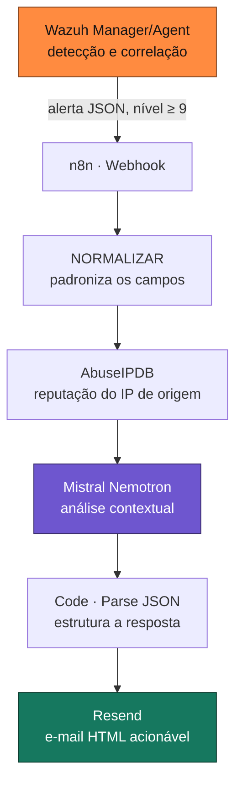

# Arquitetura

## Fluxo lógico

## Componentes

| Componente | Função | Saída principal |
|---|---|---|
| **Wazuh** (Manager + Agent) | Detecção e correlação | Alerta JSON |
| **n8n · Webhook** | Entrada do evento | Item do workflow |
| **NORMALIZAR** | Padronização dos campos | Objeto simplificado |
| **AbuseIPDB** | Enriquecimento de reputação do IP | Score, reports, país, ISP |
| **Mistral Nemotron** | Análise contextual (IA) | JSON com veredito e recomendações |
| **Code · Parse JSON** | Limpa e estrutura a resposta da IA | Campos prontos |
| **Resend** | Notificação | E-mail HTML |

## Princípios de projeto

- **Detecção determinística, IA contextual.** O Wazuh decide *se* algo é suspeito com regras. A IA entra *depois*, para explicar e recomendar — nunca para detectar ou decidir ação irreversível.
- **Cada peça faz uma coisa só.** A saída de um node é a entrada do próximo. Fácil de depurar: valide uma peça de cada vez, da esquerda para a direita.
- **Contrato de saída.** A IA é obrigada a responder num JSON de formato fixo. É isso que a torna integrável — o e-mail final é montado automaticamente a partir desses campos.
- **Segredos fora do fluxo.** Chaves de API vivem em credenciais do n8n e no `.env` local, jamais no código versionado.

## Ambiente do laboratório

- **Wazuh server:** Ubuntu 24.04 (WSL) · **Wazuh agent:** Ubuntu 22.04 (WSL)
- **n8n:** via Docker, porta `5678`
- **Windows 10/11** como host, com WSL2 e virtualização habilitada
